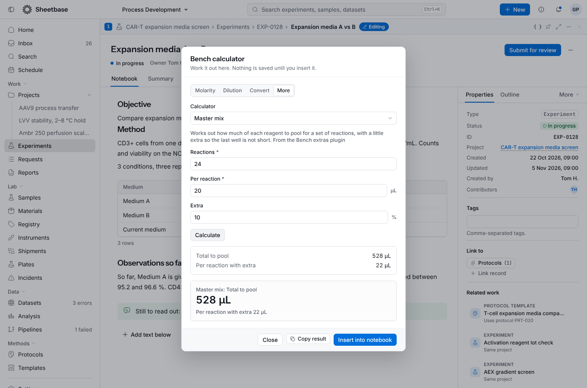
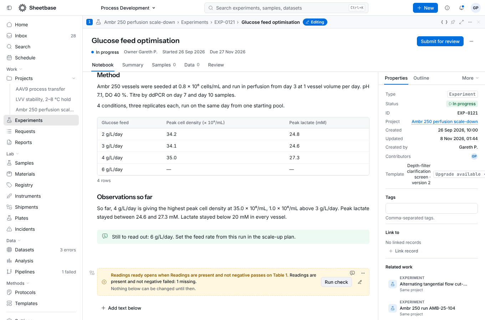
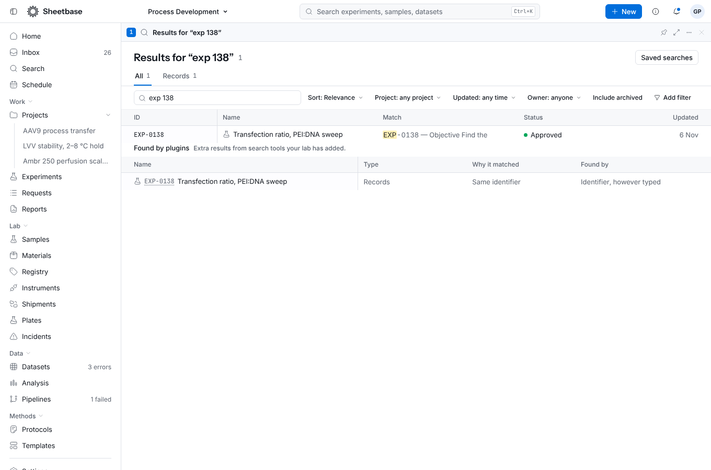
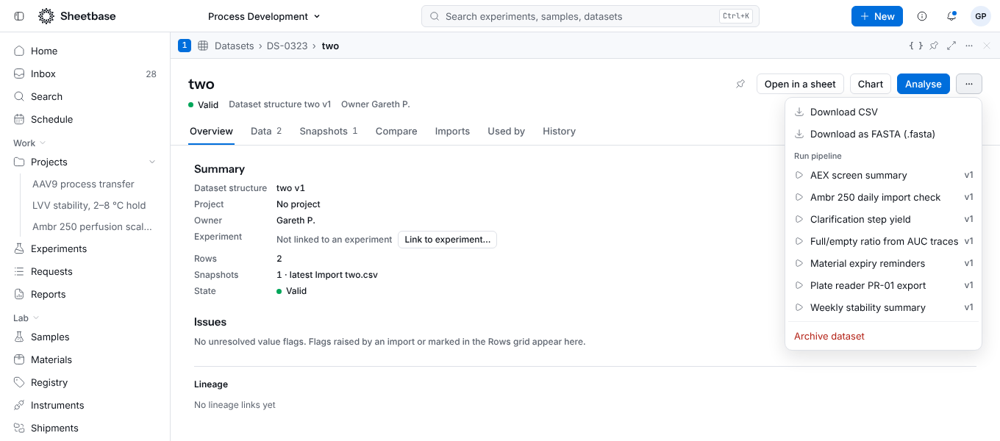
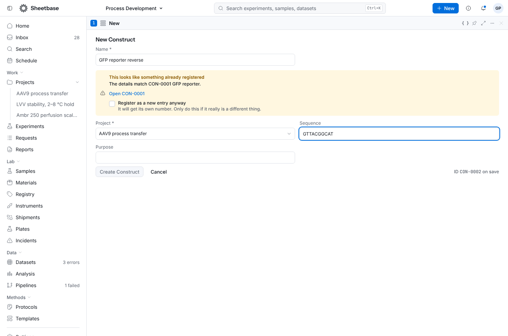
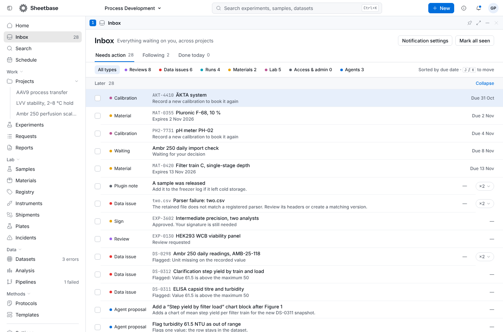
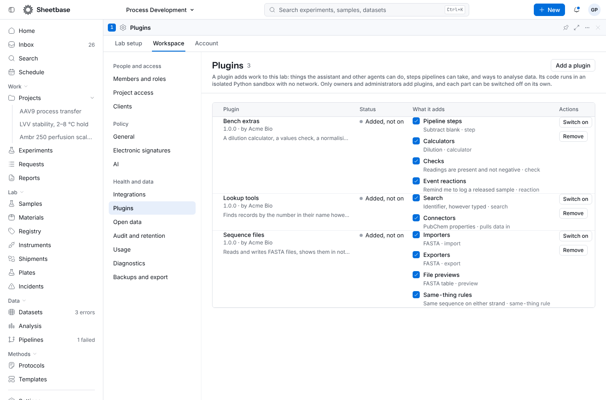

# Build a plugin

A plugin adds work to Sheetbase in Python. This page takes one from nothing to
installed, once from the author's side and once from the scientist's. The
reference is [the plugins API page](../api/plugins-api.md); the runnable example
is `sdks/plugin-python/examples/cell-count`.

## What you can add

Twelve places in the app take a plugin. Each is declared in `plugin.json` under
`provides`, points at a Python function, and has its own switch in
**Settings → Plugins**.

| Point            | Declare it as      | Your function                                     | Where people meet it                                   |
| ---------------- | ------------------ | ------------------------------------------------- | ------------------------------------------------------ |
| Operations       | `operations`       | `fn(input) -> dict`                               | Assistant, MCP, pipelines, API                         |
| Calculators      | `calculators`      | `fn(input) -> dict`                               | Bench calculator, "More" tab; also assistant, MCP, API |
| Pipeline steps   | `pipeline-steps`   | `fn(tables, settings) -> DataFrame`               | Pipelines: combine or reshape tables                   |
| Analysis kinds   | `analysis-kinds`   | `fn(rows) -> rows or DataFrame`                   | Analysis studio                                        |
| Checks           | `checks`           | `fn(df) -> {status, message}`                     | "A plugin check passes" gate condition                 |
| Search           | `search-providers` | `fn({query, documents}) -> {hits}`                | Search page, assistant, MCP                            |
| Connectors       | `connectors`       | `run(input)` and `parse({responses, parameters})` | Import: "Pull data in from another tool"               |
| Importers        | `importers`        | `fn(content, filename) -> rows`                   | Import, for file types Sheetbase does not read         |
| Exporters        | `exporters`        | `fn(rows, options) -> str or bytes`               | Dataset menu: "Download as …"                          |
| File previews    | `previews`         | `fn(content, filename) -> {kind, …}`              | Notebook file blocks: "Show as …"                      |
| Same-thing rules | `sameness-keys`    | `fn(values) -> {key}`                             | Registry: warning before a repeat is added             |
| Event reactions  | `event-hooks`      | `fn({event, record}) -> after answer`             | Inbox, record panel, record fields                     |
| Save hooks       | `record-hooks`     | `fn({record, …}) -> before or after answer`       | Saves and uploads, record panel, sign-offs, gates      |

The examples under `sdks/plugin-python/examples` (`lab-rules` shows save hooks) between them use every
point except operations and analyses (see `cell-count` for those):

- `bench-extras`: a master mix calculator, a values check, a blank-subtracting
  step and a reminder when a sample is released.
- `sequence-files`: FASTA import, export and preview, and a rule that two
  strands of one sequence are the same thing.
- `lab-rules`: save hooks: a check and fill before a save, a summary and search
  entry after one, a sign-off when an experiment goes to review, and a check on
  uploads.
- `lookup-tools`: a search that ignores dashes and leading zeros in
  identifiers, and a PubChem connector.

- **Blocks and panels**: a notebook block, or a tab on record pages. Either
  describe the screen in Python with `sheetbase_plugin.ui` (Sheetbase draws it,
  so it looks like the rest of the app), or bring a page of your own under `ui/`
  that runs in a sandboxed frame.
- **Table cells**: say how a value looks (a pill for pass/fail, a bar out of 100,
  a sparkline) with `display`, or draw it yourself with `render`: a page in
  `ui/` that is handed the values on screen and answers with an SVG, a picture
  or text for each. What reaches the table is data, so large tables stay quick
  and no plugin code runs inside a cell.
- **Your own screens, in TypeScript or JavaScript**: `pages` (a page under
  "Plugins" in the sidebar), `settings-pages` (a page in Settings, for admins),
  `dashboard-widgets` (a card on Home), `report-sections` (a section a person
  adds to a report; what you hand back is frozen into the report as text) and
  `blocks`/`panels` with `ui`. Each is an entry file in `ui/` that runs in the
  sandboxed frame. Use any npm library: you bundle it into `ui/` yourself
  (see "Screens in TypeScript" below).
- **Computed columns and column actions**: a column worked out from each row's
  fields, with entries in its header menu.
- **Row actions**: something to do with the chosen rows, such as an export.
- **Field types**: a type for a model field, such as a batch code with a pattern
  and a display. Its lengths, pattern and range are enforced by the database on
  every write (forms, API, import, assistant, pipelines) while the plugin is on
  and its field types point is switched on; the plugin's code is not run. Add
  `input: "ui/input.html"` to replace the text box with your own control, such
  as a structure drawer or a sequence editor.

Logic is Python; screens are JavaScript or TypeScript. Plugins cannot read your
data unless a call hands it to them: the Python runs in an isolated sandbox with
no network, no database and no files but its own. A plugin screen runs in a
sandboxed frame with no cookies and no view of the rest of the app; its only
way out is `fetch` to the plugin's own operations.

Each hook has a small runnable example in `sdks/plugin-python/examples`:
`dilution-block` (a block and a panel from Python screens), `ui-counter` (a block
with its own page), `cell-looks` (table cell displays and a field type) and
`plate-tools` (a computed column, a column action and two row actions) and
`sequence-tools` (every kind of screen above, written in TypeScript with d3
bundled in: a block, a field input, a cell renderer, a page, a settings page, a
Home card and a report section).

## As the author

Install the helper and make a folder to start from:

```sh
pip install sheetbase-plugin        # from sdks/plugin-python in this repository
sheetbase-plugin init cell-count
cd cell-count
```

You get a manifest and one function.

`plugin.json` says what the plugin adds:

```json
{
  "id": "acme.cell-count",
  "name": "Cell count",
  "version": "1.0.0",
  "description": "Viability and seeding volume from a cell count.",
  "provides": {
    "operations": [
      {
        "id": "viability",
        "title": "Cell viability",
        "description": "Gives the percentage of live cells from a live and a dead count.",
        "access": "read",
        "inputs": [
          { "name": "live", "type": "integer", "required": true },
          { "name": "dead", "type": "integer", "required": true }
        ],
        "outputs": [
          { "name": "viability", "type": "number", "required": true },
          { "name": "total", "type": "integer", "required": true }
        ],
        "run": "counting:viability"
      }
    ]
  },
  "examples": [
    {
      "operation": "viability",
      "input": { "live": 92, "dead": 8 },
      "output": { "viability": 92.0, "total": 100 }
    }
  ]
}
```

`python/counting.py` is plain Python:

```python
from sheetbase_plugin import PluginError

def viability(input):
    live, dead = input["live"], input["dead"]
    if live + dead == 0:
        raise PluginError("Count at least one cell.")
    return {"viability": round(100 * live / (live + dead), 1), "total": live + dead}
```

The `description` matters: the assistant reads it to decide when to use the
operation. `PluginError` is for expected problems; the message is shown to the
person as written.

Try it as you write:

```sh
sheetbase-plugin dev .     # checks the files and runs the examples on every save
sheetbase-plugin run viability --input '{"live": 0, "dead": 0}'
sheetbase-plugin pack .    # acme.cell-count-1.0.0.sbplugin
```

`run` and `dev` use the same loader the app uses, so what passes here runs there,
but on your machine there is no sandbox: keep the plugin to the standard library
and the packages the Sheetbase Python runner provides (pandas and NumPy).

## As the scientist

An owner or administrator opens **Settings → Plugins**, chooses **Add a plugin**
and picks the file. Sheetbase reads it and shows, before anything is added:

- what it is and who made it;
- what it asks for, in plain words (it runs its own Python in a sandbox with no
  network; any access it declares);
- what it adds: "Cell viability · reads", "Seeding volume · reads";
- for an update, what is new and what was dropped.

They tick that they have read it and trust it, and add it. It stays off until
they switch it on, and each part has its own switch.

From then on, with no further work from the author:

- the assistant answers "what's the viability if I counted 92 live and 8 dead?"
  by calling the operation, and shows a confirm card for anything that writes;
- an agent over MCP sees the same tool, and a write waits in the Inbox under the
  workspace's agent policy;
- a pipeline step can use "Cell viability" like any built-in action;
- a script can call it:

```sh
curl -X POST https://your-sheetbase/api/plugins/cell-count/viability \
  -H "Authorization: Bearer $SHEETBASE_TOKEN" \
  -H "Content-Type: application/json" \
  -d '{"input": {"live": 92, "dead": 8}}'
```

```python
from sheetbase import Client
Client(...).plugins.call("cell-count", "viability", {"live": 92, "dead": 8})
```

Every call is audited with the plugin and the SHA-256 of the code that ran.

## Screens

```python
from sheetbase_plugin import ui

def screen(payload):
    # payload: {"context": {...}, "state": ..., "event": None or {"action", "values"}}
    return ui.screen(
        ui.stack(
            ui.heading("Colonies"),
            ui.form(ui.number_input("count", "Count", required=True),
                    submit=ui.submit("Save", "save")),
        ),
        state={"saved": True},
    )
```

Declare it as `"screen": "module:function"` on a block or panel. A computed
column function takes the rows (a list of dictionaries) and returns one value per
row; an action takes `{"rows": [...]}` and returns a dictionary with any of
`notice`, `view` and `download`.

Try them before you pack. `sheetbase-plugin try block dilution --payload '{...}'`
(or `panel`, `column`, `column-action`, `row-action`) runs one hook on a payload and
checks the answer with the same rules Sheetbase uses. `sheetbase-plugin preview`
serves a page on your own machine: a plugin page runs in the same sandboxed frame
with the same `sheetbase-ui.js`, `sheetbase.call` runs your operations locally, and
every Python screen, column and action has a box to run it and see whether
Sheetbase would accept the answer. Nothing leaves your machine.

## Screens in TypeScript

Write each screen as a small HTML file in `ui-src/` that points at a module,
and import whatever npm libraries you like:

```html
<!-- ui-src/map.html -->
<div id="app"></div>
<script type="module" src="./map.ts"></script>
```

```ts
// ui-src/map.ts
import { arc } from 'd3-shape'
sheetbase.onContext(async (context) => {
  const response = await fetch('/operations/analyse', {
    method: 'POST',
    body: JSON.stringify({ sequence: context.state?.sequence }),
  })
  // draw with plain DOM, or any library you bundled
})
```

Then run `node sdks/plugin-ui/bin/sheetbase-plugin-ui.mjs build <plugin folder>`.
It bundles each module (and everything it imports, including CSS, images, fonts
and WebAssembly) into one script and writes `ui/map.html`, `ui/map.js` and
`ui/map.css`, which are what you declare in `plugin.json` (`"ui": "ui/map.html"`)
and pack. The output is the same on every run, so commit it. Sheetbase never
bundles or runs a build for you: the package is exactly what you wrote.

What a screen can use, besides the browser itself, is the global `sheetbase`:

- `onContext(fn)` and `onRender(fn)`: what the screen is handed. A cell renderer
  gets `[{ key, value }]` and returns `[{ key, svg?, text?, tone? }]`.
- `fetch('/operations/<id>', { method: 'POST', body })`: a proxied `fetch` to
  this plugin's own operations, run as the person (and asking them first when
  one writes). Any other address answers 404; nothing else leaves the frame.
- `call(operation, input)`, `setState(state)`, `notify(text)`, `resize()`.
- `setValue(text)` (a field input), `setSection({ title, text })` (a report
  section) and `navigate(path)` (to a page inside Sheetbase).

State saved with `setState` for pages, settings pages and widgets is kept in
that browser, for that person. A notebook block keeps its state with the block.

## The other points

Each one is a short declaration and one function. The examples show them in full;
this is what to expect.

**Calculators and pipeline steps** are called like operations. A calculator's
`inputs` and `outputs` become a form on the calculator's "More" tab (and an
assistant tool, an MCP tool and an API route). A step receives each input table
as a pandas DataFrame and returns one:

```python
def subtract_blank(tables, settings):
    df = tables["readings"].copy()
    df["value"] = df["value"] - float(settings.get("blank", 0))
    return df
```



**Checks and gates.** A check reads a table and says `pass`, `warn` or `fail`
with a message. On an experiment, a gate can require "A plugin check passes" for
a table block; **Run check** reads the table, runs the plugin and stores the
answer with a fingerprint of the table, so a gate that was met stops being met
when the table changes. `warn` counts as met.

```python
def readings_present(df):
    missing = int(df["value"].isna().sum())
    return {"status": "fail" if missing else "pass", "message": f"{missing} missing"}
```



**Search.** The provider gets the search words and the records the person may
see, and answers with hits. Results appear in their own "Found by plugins"
table, never mixed into the built-in ranking, and the assistant and MCP search
tools return them too.

```python
def search(input):
    return {"hits": [{"id": d["id"], "score": 1.0, "snippet": "Matches the number"}
                     for d in input["documents"] if input["query"] in d["title"]]}
```



**Importers and connectors** produce rows, which go through the same column
mapping and checks as a file. Sheetbase keeps the converted table, not the
original file. A connector never touches the network itself: `run` says which
URLs it needs (only the hosts it declared), Sheetbase fetches them, and `parse`
turns the answers into rows. What a person types for a connector's settings is
used for that pull only and is not stored.

**Exporters** appear in a dataset's menu as "Download as FASTA (.fasta)" and are
also available at `GET /api/export/dataset/{id}?format=plugin.<key>.<id>`.
Every download is recorded like a built-in export.



**File previews** show a file's contents on the page: return
`{"kind": "table", "columns": [...], "rows": [...]}` or `{"kind": "text", "text": "..."}`.

**Same-thing rules.** The rule gets the entry's fields (the ones it names, taken
from the model's fields of the same name) and returns a key. Entries with the
same key are flagged as repeats when someone adds one in the registry. An
administrator picks the rule in the model's registry settings. From then on
every way of adding an entry carries the key: the add-entry screen, an import and
the assistant work it out for you, and an API caller passes it as
`p_sameness_value` to `create_registry_entry`. An entry added without it, or with
a key that is already registered, is refused. Editing an entry drops its key, so
a repeat made by editing is not caught.



**Event reactions** run when something happens (see the event catalogue for
names). They answer the same way a hook that runs after a save does (see below):
notes go to the Inbox of the person whose change set them off and stay for 14
days, and they can also write a summary, add search entries, raise flags, ask for
sign-offs and change fields on records. A plugin's own changes never set
reactions or hooks off again.

```python
def remind_on_release(input):
    return {"notes": [{"title": "A sample was released",
                       "body": "Add it to the freezer log if it left cold storage."}]}
```



Everything above is listed per plugin, with a switch for each part:



## Save and upload hooks

`record-hooks` run when a record or a file is created, edited, uploaded or
changes status. Each declares `when` (any of `created`, `edited`, `status-changed`,
`uploaded`), `timing` (`before` or `after`), and optionally `kinds` (record
kinds, such as `experiment`), `statuses` (only with `status-changed`) and
`file` (`text` or `base64`, only with `uploaded`, to be handed the file's
content). The sample `lab-rules` uses all of it.

A function is handed `{when, timing, record, previous, changed, changes, file}`:
the record as it will be (before) or is (after), the record as it was, the names
of the fields that changed and, for an upload, the file's name, type, size and
(if asked for) content.

**Before a save**, a hook answers with any of:

- `refuse`: stop the save. The words are shown to the person who tried to save
  (the data API answers `422` with the plugin's name and the words).
- `warn`: let the save through and show the words.
- `set`: fill in `custom_fields`, `properties` or `tags` on what is being saved.

Nothing else is accepted. A hook before a save cannot reach another record or
table.

**After a save**, a hook answers with any of:

- `notes`: up to 5 notes for the Inbox.
- `summary`: one line shown on the record's panel, replacing the last one; an
  empty string removes it.
- `index`: entries (`index`, optional `entry`, `text` and/or `vector`) for the
  plugin's own search indexes. A search provider can answer
  `{"hits": [], "nearest": {"index": "summaries", "text": "…", "vector": [...]}}`
  to have the app rank an index by words, by a vector (any width; entries of
  another width are skipped) or both, for the person searching.
- `flags` and `clear`: raise or clear a hold on the record by key. A gate
  condition "plugin_flag" (extension key, optional flag key) is met while the
  plugin has nothing open on the record.
- `sign_off`: ask for a step pressed by a person with one of the listed `roles`
  (`approvals` needed, `independent` keeps the person whose change asked for it
  from pressing it). A plugin never signs, approves or attests. Asking again
  after it was cleared opens it afresh.
- `changes`: set `custom_fields`, `properties` or `tags` on the record or, with
  `record`, another record. Never status, title, owner, links, signatures or
  anything locked. Changes are made as the person whose change set the plugin
  off, so their access applies, and each is audited.

What to expect:

- A hook that breaks or is too slow never stops a save; the person is told it
  did not run, and the failure is in the audit trail.
- Before-save hooks see saves made through the data API, the app and the
  server's own data client: writes to records and the calls that create a
  record, edit its custom fields or change its status. Anything else that
  changes a record (a database job, a call that edits several things) reaches
  the hooks that run after a save.
- Binary file content is only handed over when the hook asks for `base64`.
- A sign-off from a plugin is an approval step, not a password signature.

## Updating

Pack a new version (change `version`) and add it the same way. Sheetbase
recognises the plugin id, shows what changed, replaces the code and switches the
plugin off until an administrator has looked at it again.

## Limits

100 files, 512 KiB each, 2 MiB in all, 4 MiB for the zip; 25 of each point per
plugin; 24 fields per declaration. A call has 60 seconds and
the runner's memory limit, like any pipeline Python step.
